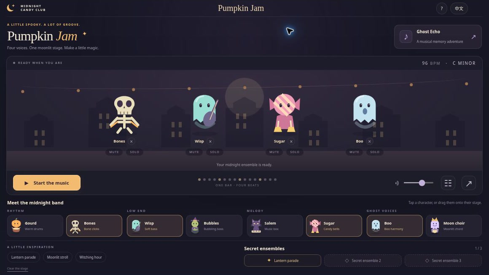
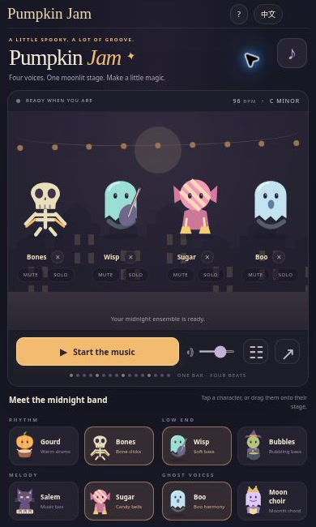

[English](README.md) · [简体中文](README.zh-CN.md) · [Español](README.es.md) · [Português (Brasil)](README.pt-BR.md) · [日本語](README.ja.md)

# Pumpkin Jam — ハロウィンの音楽づくり・音あて記憶ゲーム

🎃 かぼちゃのドラマーに、おばけの仲間を紹介しましょう。あたたかなドラム、泡のようなベース、お菓子のベル、月夜のハーモニー。Pumpkin Jam では4つのパートを組み合わせ、自分だけの小さなハロウィンバンドを作れます。

**[ブラウザーで遊ぶ](https://halloween-sprunki.crazy3d.org/)** · [全12作のハロウィンゲームを見る](https://github.com/AshinTop/halloween-games) · [⭐ GitHub で Star を付ける](https://github.com/AshinTop/halloween-sprunki)

README は5言語に対応しています。**ゲーム内の表示は現在、英語と簡体字中国語のみ**で、文書の翻訳は画面の言語を変更しません。



## このゲームの楽しみ方

- リズム、ベース、メロディー、声の4パート。それぞれ2人、計8人のオリジナルキャラクター。
- 3つのプリセットと3つの秘密の編成。演奏中の交代は次の小節から。
- パートごとの Mute、Solo、取り外し、全体の音量調整。
- 4つの音を覚える Ghost Echo は全5ラウンド。回答の制限時間はありません。
- オリジナル SVG と Web Audio の合成楽器。編成リンクの共有や動きを抑える設定に対応。

## 基本ルール

各パートに1人ずつ選ぶか、プリセットで始めます。**Start** を押すと演奏開始。ブラウザーで音を出すには、この操作が必要です。別のカードを押せば、そのパートの担当が替わります。デスクトップでは対応するステージへドラッグもできます。ベース役をメロディーの場所へ置くことはできません。

音楽は **96 BPM、ハ短調、1小節16ステップ**で統一しています。演奏中に選んだ新しい担当は、次の小節の頭から参加します。Mute は1パートを消音、Solo はそのパートだけを試聴、削除ボタンは担当を外す操作です。

### Ghost Echo で耳の記憶力を試す

**Listen** を押しておばけの音を覚え、4つのパッドで同じ順番を繰り返します。全5ラウンドで、音の数は3つから7つに増えます。間違えても聴き直せます。Echo を開くとバンドは一時停止。ページが非表示になると演奏と途中の聴き取りを止め、戻ったときは Start または Listen を押して再開します。

## 操作方法

| 操作 | 入力 |
| --- | --- |
| 演奏者を選ぶ | カードをクリック・タップ。PC では対応するパートへドラッグも可 |
| 再生・一時停止 | 再生ボタン。操作部品やダイアログの外では**スペース** |
| パートを調整 | 各担当の **Mute**、**Solo**、削除ボタン |
| 全体の音量 | 音量スライダー |
| Echo の音を答える | 自分の番に4つのパッド、または **1〜4** |
| 編成を共有 | Share を開き、表示されたリンクをコピー |

## ちょっとしたコツ

リズムとベースから始め、メロディーと声を1つずつ加えると違いが聴き取りやすくなります。Solo で1パートを確かめたら、全員の演奏へ戻しましょう。秘密の編成は、正しい4人が実際に鳴っているときに発見できます。Mute と Solo を解除し、音量を上げて次の小節を待ってください。

## 記録とチャレンジの共有

編成、消音、音量、言語、発見した編成、Echo の記録は現在のブラウザーに保存します。ほかのブラウザーとは別の記録です。保存機能が使えなくても遊べます。

この[編成リンクの例](https://halloween-sprunki.crazy3d.org/#mix=v1-1010-0000)は、4人の担当と消音設定を復元します。Solo は含めません。受け取った人が Start を押すまで音は鳴らず、録音データのアップロードも行いません。

## 画面と紹介動画



実際のゲームを小さなブラウザー iframe で撮影した画面です。小窓の配置を示すもので、実機スマートフォンの検証ではありません。

[動画プレーヤーと説明文](https://halloween-sprunki.crazy3d.org/intro.html) · [MP4 をダウンロード](docs/media/intro.mp4)

**24秒の無音紹介動画**は、実際のスクリーンショットと字幕を組み合わせています。連続プレイの録画や効果音の試聴ではなく、画面と遊び方の紹介です。

## よくある質問

### ほかの Sprunki ゲームの改造版ですか？

いいえ。キャラクター、絵、合成楽器、音楽パターン、コードを本作向けに作ったオリジナルです。同じサイトのハロウィン作品集に含まれています。

### 音が出ないときは？

Start を押してから、全体音量、各パートの Mute、端末の音量、ブラウザーの音声許可を確認してください。非表示のページから戻ったときも、Start または Listen を押します。

### 録音や楽曲の書き出しはできますか？

この版では編成をリンクで共有できます。マイク録音、WAV ファイルの書き出し、演奏のアップロードはありません。

## ローカルで実行・サイトに埋め込む

リポジトリのルートで HTTP サーバーを起動します。

```sh
python3 -m http.server 4173
```

**http://localhost:4173/** を開いてください。ビルドや依存パッケージは不要です。`file://` では JavaScript モジュールを読み込めない場合があります。

Node で付属のチェックを実行します。

```sh
npm test
```

編成リンク、秘密の組み合わせ、音楽イベント、Echo、模擬時計を使った実際の音声スケジューラーを確認します。長い停止やキャンセルも対象ですが、実機の音声遅延の計測や、人による試聴の代わりではありません。

```html
<iframe src="https://halloween-sprunki.crazy3d.org/?embed=1"
  title="Pumpkin Jam"
  style="display:block;width:100%;height:654px;border:0"
  allow="autoplay; fullscreen" allowfullscreen></iframe>
```

ブラウザーで **1160×654、390×794、390×650、844×340** の配置を確認しています。小窓ではプリセットや補足説明をダイアログに収めます。Web Audio と JavaScript モジュールが必要です。iframe の autoplay 許可があっても Start 操作は必要で、非表示後に勝手に音を再開しません。

寸法、保存、フォーカス、権限は[埋め込みガイド](EMBEDDING.md)へ。親サイトのツールバーを除いた高さを iframe に割り当ててください。

## ほかのハロウィンゲームもどうぞ

- **[Midnight Rhythm Parade](https://halloween-rhythm-parade.crazy3d.org/)** · [ソース](https://github.com/AshinTop/halloween-rhythm-parade) — 4レーンで3曲のオリジナル音楽を演奏。
- **[Ghost Lanterns 3D](https://halloween-3d.crazy3d.org/)** · [ソース](https://github.com/AshinTop/halloween-3d) — Lights Out と魂のペアのルールで、かぼちゃの庭を点灯。
- **[Haunted Hearts](https://halloween-love-game.crazy3d.org/)** · [ソース](https://github.com/AshinTop/halloween-love-game) — 2匹のおばけが扉、通路、ランタンを分け合う協力パズル。
- **[Trick-or-Treat TriPeaks](https://halloween-tripeaks.crazy3d.org/)** · [ソース](https://github.com/AshinTop/halloween-tripeaks) — 隣り合う数字のカードをつなぎ、8つの救出問題を解く。

## 制作と応援

**AshinTop** と **Midnight Candy Club** のために、人の指示・確認のもとで AI を活用し、設計、実装、レビューを行いました。絵と合成音は本作向けのオリジナルです。遠隔アカウントは不要ですが、配信元が独自のスクリプトやアクセスログを加える場合があります。

楽しめたら **[GitHub で Star](https://github.com/AshinTop/halloween-sprunki)** をぜひ。不具合報告にはブラウザー、iframe の寸法、問題のリンク、再現手順を添えてください。
